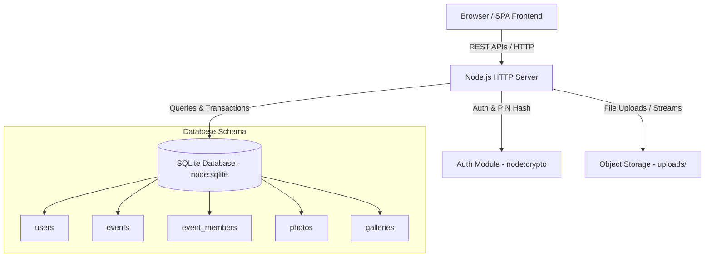

# Trizen Photo Sharing Platform 📸

<!-- tech-version-badges -->
   
<!-- /tech-version-badges -->

Full-stack, high-performance photo-sharing application built according to the **TrizenAI Technologies Software Requirement Document (SRD)**.

The platform enables photography and event teams to collaboratively upload high-resolution photographs, empowers Admins to consolidate and select photos, and publishes PIN-protected customer galleries accessible via shareable links without requiring customer account creation.

---

## 🌟 Key Features

1. **Role-Based Workflows**:
   - **Admin / Lead**: Event creation, team member assignment, photo selection, gallery publishing, PIN configuration, and live operational stats monitoring.
   - **Team Member**: Assigned event view, batch photo drag-and-drop uploader, personal upload tracking. Strict access isolation preventing unauthorized publishing or managing other members' photos.
   - **Customer**: PIN-protected gallery access (`/gallery/:accessSlug`), zero-account friction, lightbox modal preview, single-click photo downloading.

2. **Secure Photo Object Storage**:
   - Object/file storage abstraction storing binary images on disk in `uploads/` with sanitized IDs and metadata indexed in SQLite.
   - Metadata tracking: Photo ID, Event ID, Uploaded By, Filename, Storage Location, File Size, MIME type, Selection Status, Timestamps.

3. **PIN-Protected Security**:
   - 6-digit PIN hashing using `scrypt` key derivation (`node:crypto`).
   - Timing-safe PIN verification preventing side-channel timing attacks.
   - Rate-limited gallery session tokens (`GALLERY_ACCESS`) for customer authentication.

4. **Zero-External Dependency Architecture**:
   - Built with native Node.js v24 (`node:sqlite` DatabaseSync, `node:crypto`, `node:http`, `node:test`).
   - 100% offline-compatible and guaranteed zero setup failure on any Windows/Linux/macOS environment.

---

## 🏗️ System Architecture & Database Design



### Database Schema Entity Relationships

- **`users`**: `id` (PK), `email` (UNIQUE), `password_hash`, `name`, `role` ('ADMIN' | 'TEAM_MEMBER'), `created_at`
- **`events`**: `id` (PK), `title`, `description`, `event_date`, `created_by` (FK -> users.id), `created_at`
- **`event_members`**: `id` (PK), `event_id` (FK -> events.id), `user_id` (FK -> users.id), `assigned_at`
- **`photos`**: `id` (PK), `event_id` (FK -> events.id), `uploaded_by` (FK -> users.id), `filename`, `original_name`, `storage_location`, `file_size`, `mime_type`, `selected_for_gallery` (0 | 1), `created_at`
- **`galleries`**: `id` (PK), `event_id` (FK UNIQUE -> events.id), `access_slug` (UNIQUE), `pin_hash`, `status` ('DRAFT' | 'PUBLISHED'), `published_at`, `created_at`

---

## ⚡ Demo Credentials & Quick Test

| Role | Email | Password | Access / Notes |
| :--- | :--- | :--- | :--- |
| **Admin / Lead** | `admin@trizen.com` | `admin123` | Full administrative control & photo selector |
| **Team Member** | `team@trizen.com` | `team123` | Photo upload workspace for assigned events |
| **Customer** | *No Account Required* | PIN: **`482917`** | Published Gallery: `/gallery/abc123` |

---

## 🛠️ Local Setup & Running Instructions

### Prerequisites
- Node.js (v18+, v22+, or v24+)

### 1. Seed Database & Sample Event State
To populate the database with the **Arjun & Priya Wedding** demo operational state (1,250 photos, 600 selected, PIN `482917`):
```bash
node seed.js
```

### 2. Start Application Server
```bash
node server.js
```
The application will start on **`http://localhost:3000`** (or `http://localhost:3050` if port 3000 is occupied).

---

## 🧪 Running Automated Tests

Execute the comprehensive test suite covering Authentication, Photo Object Storage, Authorization, and Customer PIN-Protected Gallery workflows:

```bash
node tests/run_all.js
```

Or using native Node test runner:
```bash
node --test tests/auth.test.js tests/photos.test.js tests/gallery.test.js
```

---

## 🚀 Environment Variables

| Variable | Default Value | Description |
| :--- | :--- | :--- |
| `PORT` | `3000` (or `3050`) | Port on which the HTTP server listens |
| `DB_PATH` | `./photo_platform.db` | Absolute or relative path to SQLite database file |
| `UPLOAD_DIR` | `./uploads` | Directory path for physical photo storage |
| `JWT_SECRET` | `trizen_photo_platform_secret_key...` | Secret key used for signing JWT auth tokens |

---

## 📦 Final Deliverables Summary

- [x] Full Source Code Repository
- [x] Pre-seeded Demo Data (`Arjun & Priya Wedding`, 1,250 photos, 600 selected for gallery)
- [x] Demo Customer Gallery URL (`/gallery/abc123`) & Access PIN (`482917`)
- [x] Demo Admin Credentials (`admin@trizen.com` / `admin123`)
- [x] Demo Team Member Credentials (`team@trizen.com` / `team123`)
- [x] Automated Unit & Integration Test Suite (`node tests/run_all.js`)
- [x] Comprehensive Architecture & Setup Documentation (`README.md`)
